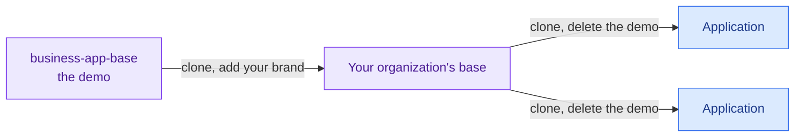

# business-app-base

A demo business application to clone and adapt. Its gallery shows every daisyUI component with an honest status and
every official example, and the approved ones are built to one standard of accessibility, usability and language
support, so a new application starts from working, tested pieces instead of from a blank page. People and AI assistants
both build faster that way.

**For whom:** teams that build internal applications, with or without AI, and want them to look and behave alike.

**What it is not:** a framework or a dependency. There is nothing to install and nothing to stay tied to. Clone it, keep
what helps, change the rest.



> **Status:** milestone 1: the application's shell with its layouts, a settings menu and a command palette (Ctrl+K or
> Cmd+K), the gallery, identity, languages, themes and every check running. Milestone 2: PostgreSQL and SQLite with exact
> decimals, a server table on 50,000 rows with Excel export, an equipment detail with tabs and a print style, charts with
> their tables, and a planning screen that groups rows and edits one at a time. Milestone 3, in review: every form field,
> a work order form with validation at the edge, file upload, a confirmation dialog, and two people on one row finding
> out. Milestone 4, in progress: lists that a person can make dense and as wide as the screen, the page's title in
> the top bar, filters in a side panel that can be hidden, charts whose parts filter a list, a board of work orders, and a timeline in Planning. The rest is in the [milestones](docs/specification.md#milestones).

## Try it

Needs [uv](https://docs.astral.sh/uv/). A copy of `.env.example` gives a fake identity for local work.

```bash
cp .env.example .env
uv run --frozen uvicorn app.main:app --reload --no-proxy-headers
```

Keep `--no-proxy-headers`: without it, Uvicorn replaces the proxy's address with the one in `X-Forwarded-For`, the
address stops being trusted, and everyone gets 401.

No database is needed for that. Without `.env` the application refuses to start, because production is the default and
production never runs on SQLite.

Equipment, planning and the dashboard's charts read generated rows. They say so, and show this command, which takes
seconds, makes a SQLite file under `.data/` and can run while the server does. Then reload the page. Everything else
works without it.

```bash
uv run --frozen python -m app.demo.generate
```

For PostgreSQL, set `APP_DATABASE_URL` and apply the migrations, then generate if you want the rows. The database tests
run on it too if `TEST_DATABASE_URL` gives one. [Data](docs/specification.md#data) says how the two differ.

```bash
uv run --frozen alembic upgrade head
```

On GitHub, a pull request runs the tests on Ubuntu, with SQLite and PostgreSQL. To run them on Windows too, start the
workflow by hand: *Actions*, *Tests*, *Run workflow*, or `gh workflow run tests.yml --ref <branch>`. Do it before
publishing, and after a change to paths or tools.

To start an application of your own, clone this, then run `uv run --frozen python tools/remove_demo.py` and
`uv run --frozen python tools/css.py`. The first is what turns the clone into an application: the demo goes, and
`AGENTS.md` stops describing a neutral base and describes an application, so real work belongs there. Fill in *What this
application is* at the top of it before anything else: every assistant reads it first. The step runs once, and a second
run changes nothing, so what you wrote stays.

## Documentation

| Page | What it contains |
|---|---|
| [Specification](docs/specification.md) | What the base contains, its data, its components, its icons and illustrations, the demo, how it is adapted, and the milestones |
| [Standards](docs/standards.md) | Every rule of accessibility, usability, language, components, data and security, with its official source and its check |
| [Components](docs/components/README.md) | Every component on offer, one page each, with its status |
| [Decisions](docs/decisions.md) | Why it is built this way, and what is still open |

How to work in this repository: [AGENTS.md](AGENTS.md).
