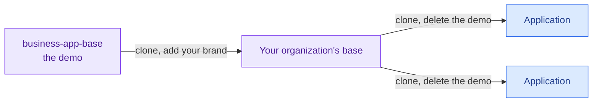

# business-app-base

A demo business application to clone and adapt. Its gallery shows every daisyUI component with an honest status and
every official example, and the approved ones are built to one standard of accessibility, usability and language
support, so a new application starts from working, tested pieces instead of from a blank page. People and AI assistants
both build faster that way.

**For whom:** teams that build internal applications, with or without AI, and want them to look and behave alike.

**What it is not:** a framework or a dependency. There is nothing to install and nothing to stay tied to. Clone it, keep
what helps, change the rest.



> **Status:** milestone 1: the application's shell with its layouts, a settings menu and a command palette (Ctrl+K or
> Cmd+K), the gallery, identity, languages, themes and every check running. The rest is in the
> [milestones](docs/specification.md#milestones).

## Try it

Needs [uv](https://docs.astral.sh/uv/). A copy of `.env.example` gives a fake identity for local work.

```bash
cp .env.example .env
uv run --frozen uvicorn app.main:app --reload --no-proxy-headers
```

Keep `--no-proxy-headers`: without it, Uvicorn replaces the proxy's address with the one in `X-Forwarded-For`, the
address stops being trusted, and everyone gets 401.

To start an application of your own, clone this, then run `uv run --frozen python tools/remove_demo.py` and
`uv run --frozen python tools/css.py`.

## Documentation

| Page | What it contains |
|---|---|
| [Specification](docs/specification.md) | What the base contains, its components, the demo, how it is adapted, and the milestones |
| [Standards](docs/standards.md) | Every rule of accessibility, usability, language, components and security, with its official source and its check |
| [Components](docs/components/README.md) | Every component on offer, one page each, with its status |
| [Decisions](docs/decisions.md) | Why it is built this way, and what is still open |

How to work in this repository: [AGENTS.md](AGENTS.md).
