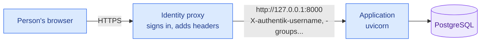

# Deployment

An application runs on a Linux server behind a reverse proxy that signs people in. The application never sees a
password: the proxy says who the person is in headers, and the application believes them only from the proxy's
address. This page is the shortest path that holds; an organization's own way of shipping (containers, a deployment
tool) does the same steps.



## 1. What the server needs

| Need | Why |
|---|---|
| [uv](https://docs.astral.sh/uv/) | It installs the locked packages, `uv.lock`, and the Python the project names |
| PostgreSQL | Production never runs on SQLite: the application refuses to start |
| A reverse proxy that signs people in | The application has no login of its own ([Identity](specification.md#identity)) |
| A folder for uploaded files, outside the application's folder | Nothing a person sends can be served or run |

## 2. Install and migrate

From a clean checkout of the version to run, as the user the service runs as:

```bash
uv sync --frozen --no-dev
uv run --frozen alembic upgrade head      # with the settings below in the environment
```

`alembic upgrade head --sql` writes the SQL instead of running it, to read it first. Run the migration on every new
version, before the service starts it.

## 3. Settings

Every setting is an environment variable starting with `APP_`; `.env.example` lists them for local work, and
`app/core/settings.py` says what each one is. In production these matter:

| Setting | Value |
|---|---|
| `APP_ENVIRONMENT` | `production`, which is also the default |
| `APP_NAME` | The application's name, as people see it |
| `APP_DATABASE_URL` | The PostgreSQL address, `postgresql+psycopg://` with the user, its credential, the host and the database, from the service's secrets, never in the repository |
| `APP_UPLOAD_FOLDER` | A folder outside the application's, writable by the service |
| `APP_TIME_ZONE` | The organization's, such as `Europe/Madrid`: what dates and times show in |
| `APP_DEFAULT_LANGUAGE`, `APP_LANGUAGES` | The languages offered and the last resort |
| `APP_TRUSTED_PROXIES` | The proxy's address as the application sees it: `["127.0.0.1"]` when both run on the same server |
| `APP_HEADER_USERNAME`, `APP_HEADER_NAME`, `APP_HEADER_EMAIL`, `APP_HEADER_GROUPS`, `APP_GROUPS_SEPARATOR` | The proxy's header names and how it joins groups. Defaults: `X-Remote-User`, `X-Remote-Name`, `X-Remote-Email`, `X-Remote-Groups`, `\|` |
| `APP_ROLE_GROUPS` | Each role and the groups that give it, `*` standing for any text: `{"admin": ["app-admins"], "manager": ["departamento-*"]}`. Everyone the proxy identified also has `signed_in` |

`APP_FAKE_IDENTITY` stays off: it refuses to start outside development.

## 4. The service

A systemd unit, `/etc/systemd/system/<application>.service`:

```ini
[Unit]
Description=<Application>
After=network-online.target postgresql.service

[Service]
User=<application>
WorkingDirectory=/srv/<application>
EnvironmentFile=/etc/<application>/environment
ExecStart=/srv/<application>/.venv/bin/uvicorn app.main:app --host 127.0.0.1 --port 8000 --no-proxy-headers
Restart=on-failure
NoNewPrivileges=true
ProtectSystem=strict
ReadWritePaths=/var/lib/<application>

[Install]
WantedBy=multi-user.target
```

It runs the environment `uv sync` made in step 2, so the service writes nothing but its uploads. This unit is an
example to adapt; it has not been run as it is on every distribution. `/etc/<application>/environment` holds the settings above, readable by that user alone (`chmod 600`), with
`APP_UPLOAD_FOLDER=/var/lib/<application>/uploads`. Uvicorn listens on `127.0.0.1` only, so nothing reaches it but the
proxy. Keep `--no-proxy-headers`: without it Uvicorn replaces the proxy's address with the one in `X-Forwarded-For`,
the address stops being trusted, and everyone gets 401. `GET /health` answers without identity, for the proxy's or a
monitor's checks.

## 5. The identity proxy

Any proxy that signs people in and passes who they are in headers will do. The application reads four, and the proxy
must remove any a browser sends itself. Set the header names and the separator to the proxy's own.

**authentik**, as a proxy provider in forward-auth or proxy mode, sends, per its
[documentation](https://docs.goauthentik.io/add-secure-apps/providers/proxy/) (read 2026-11-11): `X-authentik-username`,
`X-authentik-name`, `X-authentik-email` and `X-authentik-groups`, the groups "separated by pipes". So:

```bash
APP_HEADER_USERNAME=X-authentik-username
APP_HEADER_NAME=X-authentik-name
APP_HEADER_EMAIL=X-authentik-email
APP_HEADER_GROUPS=X-authentik-groups
APP_GROUPS_SEPARATOR=|
APP_ROLE_GROUPS={"admin": ["app-admins"], "manager": ["departamento-*"]}
```

The groups are those authentik holds, synchronized from the directory (Entra ID, LDAP) where it is set up so. Which
people may open the application at all is the provider's own setting: an application's access policy, bound to a
group.

**oauth2-proxy** sends `X-Forwarded-User`, `X-Forwarded-Email`, `X-Forwarded-Preferred-Username` and
`X-Forwarded-Groups` (`--pass-user-headers`), or the `X-Auth-Request-*` ones for nginx's `auth_request`
(`--set-xauthrequest`), per its [documentation](https://oauth2-proxy.github.io/oauth2-proxy/configuration/overview).
It names no header for the person's full name, and its documentation does not say how it joins groups: check what it
sends before setting `APP_GROUPS_SEPARATOR`.

## 6. Check it

After the first start, through the proxy:

| Check | Expected |
|---|---|
| `curl -s http://127.0.0.1:8000/health` on the server | `{"status":"ok"}`, without identity |
| The address in a browser, signed in | The application, with the person's name in its user menu |
| The same address with no proxy in between, from another computer | Nothing: Uvicorn listens on `127.0.0.1` only |
| A request to `127.0.0.1:8000` with an identity header and no proxy, on the server | 401 if the server's own address is not in `APP_TRUSTED_PROXIES`; with it, anyone on the server can claim an identity, so the server's users are as trusted as the proxy |
| A screen asking for a role, as someone without its group | 403 |
